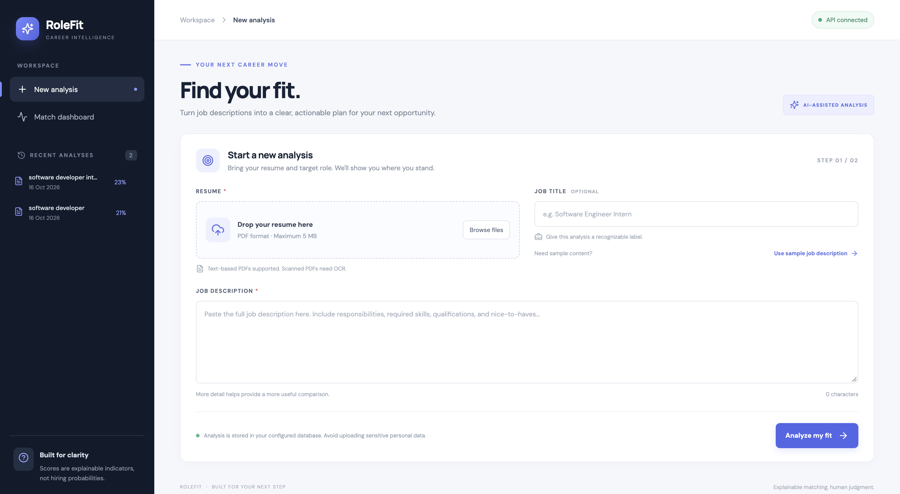
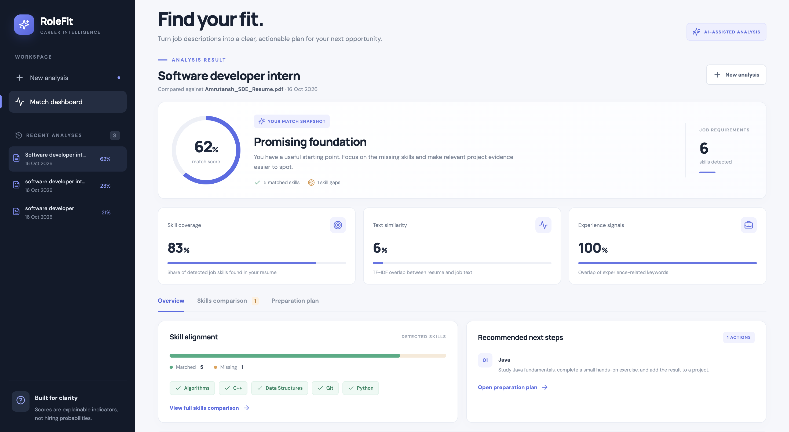
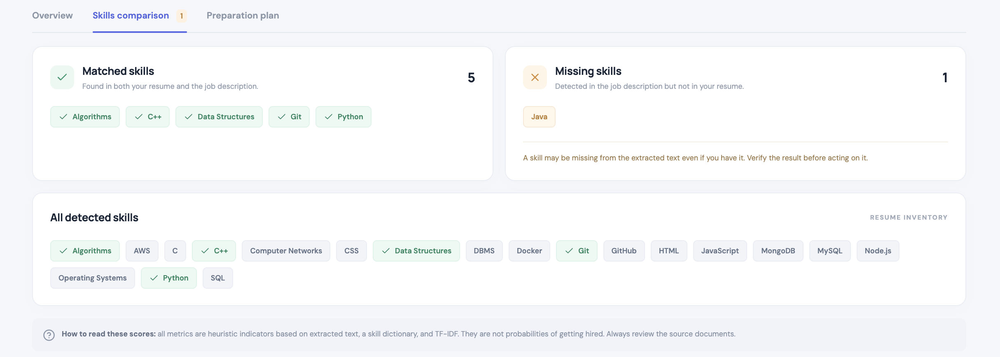

# RoleFit — AI-Powered Job Match & Resume Analyzer

<p align="center">
  <strong>Understand your fit for a role. Find skill gaps. Build your next-step plan.</strong>
</p>

## 🚀 Live Demo

**Try RoleFit here:** [Open Live Application](https://ai-powered-job-match-resume-analyze.vercel.app/)

Upload your resume, paste a job description, and analyze your job match score, matched skills, and missing skills.

<p align="center">
  
  
  
  
  
  
  
  
</p>

RoleFit is a full-stack portfolio project that compares a text-based PDF resume with a job description. It identifies matching skills, highlights potential skill gaps, calculates explainable matching indicators, and suggests practical next steps.

> **Important:** Match scores are heuristic indicators, not probabilities of getting hired or guarantees of employability. Review the extracted text and recommendations yourself.

## Contents

- [Features](#features)
- [Product Preview](#product-preview)
- [Tech Stack](#tech-stack)
- [How Matching Works](#how-matching-works)
- [Architecture](#architecture)
- [Getting Started](#getting-started)
- [Run Tests](#run-tests)
- [API Reference](#api-reference)
- [Project Structure](#project-structure)
- [Limitations and Responsible Use](#limitations-and-responsible-use)
- [Roadmap](#roadmap)
- [License](#license)

## Features

- **PDF Resume Parsing:** Extract text from text-based PDF resumes using `pypdf`.
- **Job Description Analysis:** Enter a target role and paste its job description.
- **Skill Extraction:** Detect known technical skills using a controlled dictionary.
- **Explainable Matching:** Display skill coverage, TF-IDF cosine similarity, and experience-keyword overlap separately.
- **Skill Gap Analysis:** Identify skills found in the job description but not detected in the resume.
- **Preparation Plan:** Generate suggested learning actions for potential skill gaps.
- **Analysis History:** Save, reopen, compare, and delete previous analyses.
- **REST API:** Expose analysis and history operations through FastAPI.
- **Database Flexibility:** Use SQLite locally or configure PostgreSQL.
- **Developer Tooling:** Include tests, Dockerfiles, Docker Compose, and environment examples.

## Product Preview

### Dashboard

<p align="center">
  
</p>

### Resume Analysis Results

<p align="center">
  
</p>

### Skills Comparison

<p align="center">
  
</p>

## Tech Stack

| Layer | Technology | Purpose |
|---|---|---|
| Frontend | React, TypeScript, Vite | Interactive dashboard |
| Backend | Python, FastAPI | REST API and validation |
| PDF Parsing | pypdf | Extract resume text |
| Matching | scikit-learn | TF-IDF and cosine similarity |
| Skill Extraction | Python regular expressions and a controlled dictionary | Detect known skills |
| Persistence | SQLAlchemy, SQLite / PostgreSQL | Save analysis history |
| Testing | pytest, FastAPI TestClient | Test backend behavior |
| Development | Git, Docker, Docker Compose | Version control and containerization |

## How Matching Works

1. Extract text from the uploaded PDF resume.
2. Detect known skills in the resume and job description.
3. Calculate skill coverage based on detected job skills also detected in the resume.
4. Calculate text similarity using TF-IDF vectors and cosine similarity.
5. Estimate experience-keyword overlap using selected experience-related terms.
6. Generate a preparation plan from detected missing skills.

The combined score uses a hand-weighted heuristic:

- **Skill coverage:** 60%
- **TF-IDF text similarity:** 30%
- **Experience-keyword overlap:** 10%

These weights are not calibrated against hiring outcomes. The skill dictionary may miss synonyms or detect terms without understanding context. A missing skill means it was not detected in the extracted resume text; it does not prove the candidate lacks that skill.

## Architecture

```text
React + TypeScript (Vite)
          |
          | HTTP / JSON + multipart PDF upload
          v
       FastAPI
          |
          +--> PDF text extraction (pypdf)
          +--> Skill dictionary and TF-IDF matcher
          +--> Learning-plan generation
          |
          v
      SQLAlchemy
          |
          +--> SQLite (default)
          +--> PostgreSQL (when configured)
```


## 🚀 Getting Started

The frontend is deployed on Vercel, and the backend API is hosted on Render.

### 💻 Run Locally

Follow these steps to run RoleFit on your local machine.

#### Prerequisites

- Node.js and npm
- Python 3.10+
- Git

#### 1. Clone the Repository

```bash
git clone https://github.com/ayushvijaycode/AI-Powered-Job-Match-Resume-Analyzer.git
cd AI-Powered-Job-Match-Resume-Analyzer
```

#### 2. Set Up the Backend

```bash
cd backend
python -m venv .venv
```

Activate the virtual environment:

**macOS / Linux**
```bash
source .venv/bin/activate
```

**Windows**
```bash
.venv\Scripts\activate
```

Install dependencies:

```bash
pip install -r requirements.txt
```

Start the backend:

```bash
uvicorn app.main:app --reload
```

The API will be available at `http://127.0.0.1:8000`.

API documentation: `http://127.0.0.1:8000/docs`

#### 3. Set Up the Frontend

Open a new terminal from the project root:

```bash
cd frontend
npm install
```

Create a `.env` file inside the `frontend` directory:

```env
VITE_API_BASE_URL=http://127.0.0.1:8000
```

Start the frontend:

```bash
npm run dev
```

Open the local URL displayed in the terminal, usually `http://localhost:5173`.

### ⚙️ Configuration

The frontend uses `VITE_API_BASE_URL` to identify the backend API.

For local development, set it to:

`http://127.0.0.1:8000`

For production, the deployed frontend uses the Render backend URL configured in Vercel.

Refer to `backend/.env.example` for the backend configuration options.

### 📝 Notes

- Keep the backend running while using the locally hosted frontend.
- Configure the backend's `CORS_ORIGINS` to allow the frontend origin.
- Do not commit `.env` files containing secrets or credentials.

## Project Structure

```text
.
├── backend/
│   ├── app/
│   │   ├── main.py
│   │   ├── matcher.py
│   │   ├── parser.py
│   │   ├── models.py
│   │   ├── schemas.py
│   │   ├── database.py
│   │   └── config.py
│   ├── tests/
│   ├── requirements.txt
│   └── Dockerfile
├── frontend/
│   ├── src/
│   ├── package.json
│   └── Dockerfile
├── docs/
│   └── screenshots/
│       ├── dashboard.png
│       ├── analysis-results.png
│       └── skills-comparison.png
├── sample_data/
├── docker-compose.yml
├── PROJECT_INFO.md
├── README.md
└── LICENSE
```

## Limitations and Responsible Use

- **Text-based PDFs only:** Scanned PDFs require OCR, which is not implemented.
- **Controlled skill vocabulary:** Some skills, synonyms, and alternative spellings may not be recognized.
- **Heuristic scores:** The weights are not trained or calibrated against actual hiring outcomes.
- **Simple experience signal:** Keyword overlap does not verify the duration or quality of experience.
- **Development MVP:** Authentication and per-user authorization are not implemented. Do not expose this version publicly for real resumes without appropriate access controls, secure file handling, privacy notices, retention/deletion policies, and rate limiting.
- **Human review required:** RoleFit is intended to support job-seeker preparation, not automated hiring decisions.

## Roadmap

- [ ] Add authentication and per-user analysis isolation.
- [ ] Add optional OCR support for scanned resumes.
- [ ] Expand the skill taxonomy and synonym handling.
- [ ] Compare TF-IDF with sentence embeddings using a manually labeled evaluation dataset.
- [ ] Document evaluation methodology and matching metrics.
- [ ] Add CI for automated tests and frontend build checks.
- [ ] Deploy a demo using privacy-conscious sample data.

## License

This project is licensed under the MIT License. See [LICENSE](LICENSE) for details.

Distributed under the MIT License. See [`LICENSE`](LICENSE).
